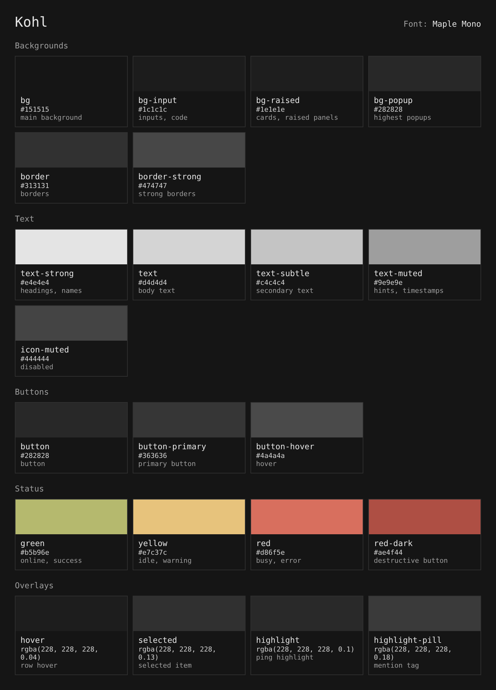

# Kohl

A minimal dark colour scheme built around
deep blacks, muted greys, and subtle earthy accents.

## Preview

## Features

- Deep monochromatic backgrounds
- Carefully balanced grey tones
- Subtle earthy status colours
- Consistent contrast and hierarchy
- Maple Mono as the recommended font

## Colour Palette

### Backgrounds
| Name | Hex |
|------|-----|
| bg | #151515 |
| bg-input | #1c1c1c |
| bg-raised | #1e1e1e |
| bg-popup | #282828 |

### Text
| Name | Hex |
|------|-----|
| text-strong | #e4e4e4 |
| text | #d4d4d4 |
| text-subtle | #c4c4c4 |
| text-muted | #9e9e9e |

## Font

Recommended font: Maple Mono

## License

MIT License
